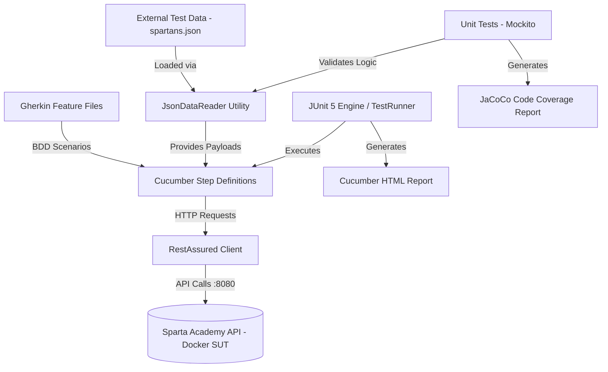

# Sparta Academy API Test Automation Framework

An automated Behaviour-Driven Development (BDD) test framework designed to test and validate the RESTful endpoints of the Sparta Academy API System Under Test (SUT).

---

## Framework Architecture



---

## Tech Stack and Tools

- Java 17: Core programming language.
- RestAssured: HTTP client library for RESTful API testing.
- Cucumber (BDD): Gherkin syntax scenarios for business-readable test specifications.
- JUnit 5 Platform Suite: Test runner and execution engine.
- Mockito: Mocking framework for unit testing.
- JaCoCo: Code coverage metrics generator.
- Docker: Containerisation platform hosting the SUT.
- GitHub Actions: Continuous Integration (CI) pipeline running unit tests on pull requests with auto-merge.

---

## Prerequisites

Ensure you have the following installed locally:
1. Docker Desktop (Engine running).
2. Java JDK 17 or higher.
3. Apache Maven 3.8+ (or use IntelliJ bundled Maven).
4. Git.

---

## Setup and Installation

### 1. Start the API System Under Test (SUT)
Navigate to the directory containing the SUT Dockerfile and run:
```bash
docker build -t spartaacademyapi .
docker run -d -p 8080:8080 -p 8081:8081 --name sparta_api spartaacademyapi
```
Verify the API is running by visiting the Swagger UI in your browser:
http://localhost:8080/swagger

### 2. Clone the Test Framework Repository
```bash
git clone https://github.com/Farid1199/sparta-api-test-framework.git
cd sparta-api-test-framework
```

---

## Test Execution Guide

### Run All Automated API and Unit Tests
To run the entire test suite and produce JaCoCo coverage reports:
```bash
mvn clean test jacoco:report
```

### Run API Functional Tests Only
Execute TestRunner.java directly in IntelliJ, or run:
```bash
mvn test -Dtest=TestRunner
```

### View Visual Test Reports
- Cucumber HTML Report: Open target/cucumber-reports/report.html in any web browser.
- JaCoCo Code Coverage Report: Open target/site/jacoco/index.html in any web browser.

---

## CI/CD Pipeline (GitHub Actions)

A GitHub Actions workflow (.github/workflows/ci.yml) triggers on every Pull Request targeting the main branch:
1. Checks out repository code.
2. Sets up JDK 17 with Maven caching.
3. Compiles and executes framework unit tests (JsonDataReaderTest).
4. Generates code coverage metrics via JaCoCo.
5. Automatically merges the Pull Request if all checks pass.

---

## Defect Tracking

All defects identified during testing are tracked in DEFECT_REPORT.md and logged in GitHub Issues.
- DEF-001: HTTP 500 error on POST /api/spartans due to route mismatch in CreatedAtAction("GetSupplier") (Resolved and Verified).

---

## Contribution Guidelines

1. Fork or branch from main:
```bash
git checkout -b feature/your-feature-name
```
2. Adhere to BDD best practices: write scenarios in Gherkin syntax under src/test/resources/features/.
3. Provide unit tests for any new utility logic in src/test/java/com/sparta/unit/.
4. Ensure all unit and API tests pass locally before pushing.
5. Submit a Pull Request targeting main. The CI pipeline will automatically validate your build and merge upon passing.